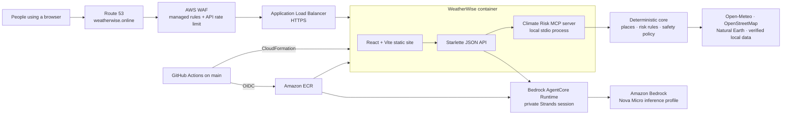

# WeatherWise Architecture

WeatherWise is a single-container climate-safety application deployed to Amazon ECS Fargate in `us-east-2`. It serves the React website and Python API together; there is no database or persistent user store.

## Request and safety flow

The application serves the website and `/api/*` endpoints from port `8080`. A chat request goes through the API to a private AgentCore Runtime session, which runs the Strands agent team and uses Amazon Bedrock (`us.amazon.nova-micro-v1:0` in the current stack). Agents obtain climate facts only from the local Climate Risk MCP server packaged in the runtime. Its deterministic core resolves places, calls approved data sources, applies rules from `rules/`, and returns verified facts. Safety hooks prevent invented numbers, prioritize official alerts, and apply flood-response constraints before a reply is returned.

`/api/status` does not invoke a model. It confirms that the API and agent configuration initialized correctly.

## AWS boundary

CloudFormation creates a VPC, two public subnets, an internet-facing ALB, Fargate service, a private AgentCore Runtime, CloudWatch log group, runtime IAM roles, and WAF. Once the Route 53 hosted zone is delegated, it also creates and renews a DNS-validated ACM certificate in `us-east-2`, Alias records for the apex and `www` hostnames, and redirects HTTP plus `www` traffic to the HTTPS apex URL. The ECS task can invoke only its own AgentCore runtime, which has its own Bedrock and observability role. The task security group accepts port `8080` only from the ALB. Tasks have public egress for weather-data calls, avoiding a NAT Gateway. The optional Open-Meteo key is injected from Secrets Manager; AWS access keys are never stored in the task or GitHub.

## Delivery path

Every branch push runs lint, tests, website build, and a container smoke test. A successful push to `main` uses GitHub OIDC to publish commit-tagged and `main` images to ECR, then updates the `weatherwise-prod` CloudFormation stack with the immutable commit tag. The OIDC roles trust only this repository's immutable GitHub subject on `main`.

## Operational notes

The container cache is in `/tmp`, so it is disposable on task replacement. CloudWatch retains ECS logs for 14 days. AgentCore sessions expire after two minutes idle to limit runtime memory costs. The public endpoint is `https://weatherwise.online`.
