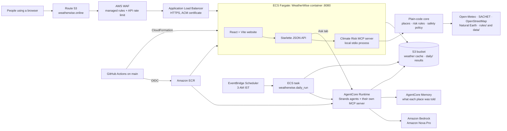

# WeatherWise architecture

WeatherWise runs in one AWS account in `us-east-2` (Ohio), from one CloudFormation stack
(`cloudformation/weatherwise-service.yaml`). The website and its API run in one container on ECS
Fargate; the Strands agents run on Amazon Bedrock AgentCore Runtime and use Amazon Nova Pro on
Amazon Bedrock. There is no user database: nothing about people is stored.

## Two journeys

- **Today, shelters, the flood guide, replays: no AI.** The API asks the MCP server, which runs
  plain code: it resolves the place, fetches forecasts, river flow and official warnings, and
  applies the rules in `rules/`. The website shows the result.
- **Ask (chat): the agents.** The API sends the question and the earlier turns to a private
  AgentCore Runtime session. The Orchestrator and its specialists (Warning agent, Flood Guide
  agent) get every fact from the MCP server packaged in the runtime, Nova Pro writes the reply,
  and the Evaluator checks it in code before it is returned. The website shows each agent step as
  it happens.

## The morning run

Every day at 3 AM IST, EventBridge Scheduler starts a short Fargate task (the same image, another
command: `python -m weatherwise.daily_run`). For each of the 25 places in `data/daily_watch.toml`
it calls the warning Graph on AgentCore: code scans the risk, an agent writes the warning, update
or all-clear (reading AgentCore Memory for what it said in the last 3 days), the Evaluator and a
final code gate check it, and delivery rules decide what a household would receive. The report
goes to S3 (`daily/`) and is shown at https://weatherwise.online/impact#live.

## Storage

- **S3 bucket** (encrypted, private): the weather cache shared by the website's container and
  AgentCore, kept across deploys, and the morning run's results. Objects expire after 400 days.
- **Weather cache layers** (`weatherwise/cache.py`): the container's own disk, then the S3 bucket,
  then a read-only seed shipped in the image (`data/cache_seed/`).
- **AgentCore Memory** (`PlaceMemory`): short-term events only, kept 30 days, keyed by place. It
  holds what the morning agent told each watched place, never anything about a person.

## AWS boundary

CloudFormation creates a VPC with two public subnets, the internet-facing ALB, the Fargate
service, the AgentCore Runtime and Memory, the S3 bucket, the morning-run task and schedule,
CloudWatch log groups, X-Ray Transaction Search, IAM roles and AWS WAF. With a Route 53 hosted
zone it also creates a DNS-validated ACM certificate, Alias records for the apex and `www`, and
redirects HTTP and `www` to `https://weatherwise.online`.

The ECS task can invoke only its own AgentCore runtime; the runtime has its own role for Bedrock,
Memory, S3 and observability. The task security group accepts port 8080 only from the ALB. Tasks
have public egress for weather-data calls, which avoids a NAT Gateway. The optional Open-Meteo key
comes from Secrets Manager; no AWS access keys are stored in the task or in GitHub.

## Delivery path

Every push runs lint, tests (server and website), the website build and a container smoke test.
A push to `main` then uses GitHub OIDC to publish commit-tagged images (API and AgentCore) to ECR
and updates the `weatherwise-prod` stack with those tags. The OIDC roles trust only this
repository's `main` branch.

## Operations

- Logs: CloudWatch, kept 14 days. AgentCore traces (ADOT) record agent steps, Bedrock calls and
  tool timing, without chat content or tool payloads.
- AgentCore chat sessions stop after two minutes idle; the API sends the earlier turns each time,
  so a restarted session keeps the conversation.
- Chat limits in the API (per visitor per minute, and a daily cap) bound model spend.
